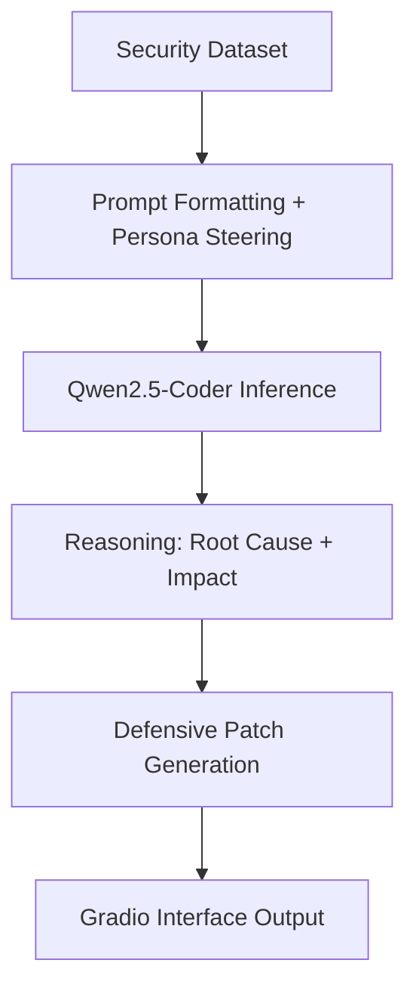

<div align="center">

# 🛡️ CyberSec-BugBounty-AI-Assistant

**Defensive Code LLM Advisor for Bug Bounty Research & Secure Code Remediation**

[](LICENSE)  
[](#)  
[](#)  
[](#)  

</div>

## Overview

CyberSec-BugBounty-AI-Assistant is a notebook-first AI security assistant designed to help security researchers, bug bounty hunters, and engineers reason about vulnerability root causes and genera[...]

This project is intentionally built for a practical security workflow: identify the likely issue, explain the root cause in plain language, and propose a secure replacement that follows secure cod[...]

---

## Why this project matters

Modern security work is bottlenecked by the time required to reason through vulnerable code, map the issue to a concrete CWE/OWASP class, and rewrite the fix without introducing regressions. This [...]

- a defense-oriented system persona
- domain-specific security instruction tuning
- a lightweight, GPU-friendly model pipeline
- a browser-based interaction layer for fast iteration

The result is a workflow that can accelerate triage, vulnerability explanation, and secure patch generation for common classes such as SQL injection, command injection, XSS, unsafe deserialization[...]

---

## Core capabilities

- Vulnerability root-cause analysis from user input and code snippets  
- Explanation of exploit mechanics and security impact  
- Defensive patch generation for Python, JavaScript, and C/C++ code  
- Secure coding guidance for sanitization, validation, and least-privilege patterns  
- Interactive exploration through a Gradio web interface  
- Notebook-based workflow designed for free GPU environments such as Google Colab

---

## Executive summary

Project Name: CyberSec-BugBounty-AI-Assistant (Defensive Code LLM Advisor)

Domain: Applied AI Engineering / Cybersecurity (Bug Bounty Research & Vulnerability Remediation)

Core function: a specialized domain-adapted LLM application engineered to perform root-cause analysis for web and system vulnerabilities (OWASP Top 10, XSS, SQLi, OS command injection, unsafe file[...]

---

## Technical architecture

This project uses a Qwen2.5-Coder decoder-only transformer architecture and integrates several modern LLM engineering methods that are important for efficiency and generation quality.

### 1) RMSNorm

Root Mean Square Normalization replaces layer normalization's mean-centering step with a scale-preserving form:

$$\text{RMS}(x) = \sqrt{\frac{1}{d} \sum_{i=1}^{d} x_i^2 + \epsilon}, \\qquad \bar{x}_i = \frac{x_i}{\text{RMS}(x)} \cdot \gamma_i$$

where $d$ is the hidden dimension, $\epsilon = 10^{-6}$, and $\gamma$ is a learnable scale parameter.

### 2) RoPE (Rotary Positional Embeddings)

RoPE encodes relative token positions by rotating query/key vectors in the complex plane:

$$e^{im\theta_i} = \cos(m\theta_i) + i\sin(m\theta_i), \\qquad \theta_i = 10000^{-2(i-1)/d_{\text{head}}}$$

This helps attention models preserve relative positional structure while being efficient at long-context reasoning.

### 3) Grouped Query Attention (GVA/GQA)

Grouped Query Attention reduces memory bandwidth by sharing key/value heads across multiple query heads. This is especially valuable for constrained GPU memory and high-throughput generation.

### 4) KV cache

During autoregressive decoding, previously computed Key/Value states are cached in VRAM so the model does not recompute the full attention history for every new token. This significantly reduces infer[...] 

### 5) SwiGLU feed-forward blocks

The feed-forward network uses a gated SiLU activation:

$$\text{FFN}(x) = \left(\text{SiLU}(xW_1) \otimes (xW_3)\right) W_2, \\quad \text{SiLU}(z)=z\cdot\sigma(z)$$

This architecture is efficient and widely used in modern transformer systems.

---

## Dataset and domain alignment

The notebook is designed around a cybersecurity instruction-tuning dataset based on security examples and remediation tasks.

- Dataset source: Trendyol/Trendyol-Cybersecurity-Instruction-Tuning-Dataset
- Approximate size: 53,201 instruction-response pairs
- Schema: system, user, assistant

The system persona is explicitly tuned to behave like a defensive security analyst. The user prompts contain security questions, harmful patterns, vulnerable code, and exploit scenarios; the assi[...]

This was a key design choice: the model is not just generating code, it is being steered toward security reasoning and remediation rather than exploitation.

---

## Hardware strategy and memory optimization

The project was engineered specifically for free Google Colab usage with an NVIDIA T4 GPU (16 GB VRAM).

### Optimization strategy

- FP16 model weights for lower memory usage and Tensor Core acceleration  
- Inference-mode execution using `@torch.no_grad()` to avoid storing gradients  
- Explicit memory cleanup using `gc.collect()` and `torch.cuda.empty_cache()`  
- Generation parameters tuned for responsive interactive use: temperature = 0.6, top-p = 0.9, max_new_tokens = 512

This makes the notebook practical for users working in constrained GPU environments without requiring expensive infrastructure.

---

## Software stack

- Language: Python 3.10+
- Deep learning engine: PyTorch 2.0+
- AI stack: Hugging Face `transformers`, `datasets`, `accelerate`
- Base model: Qwen/Qwen2.5-Coder-1.5B-Instruct
- UI layer: Gradio 4.x
- Version control: Git / GitHub

---

## Project flow



<!-- Fallback for viewers that cannot render mermaid diagrams -->

If your viewer cannot render the mermaid diagram, here is the same flow in plain text:

Security Dataset -> Prompt Formatting + Persona Steering -> Qwen2.5-Coder Inference -> Reasoning: Root Cause + Impact -> Defensive Patch Generation -> Gradio Interface Output

Or as a simple ASCII flow:

Security Dataset
    |
Prompt Formatting + Persona Steering
    |
Qwen2.5-Coder Inference
    |
Reasoning: Root Cause + Impact
    |
Defensive Patch Generation
    |
Gradio Interface Output

---

## Quickstart

### Option 1: Run directly in Google Colab

[Open in Colab](https://colab.research.google.com/github/muhammadhurres/CyberSec-BugBounty-AI-Assistant/blob/main/CyberSec_BugBounty_AI_Assistant.ipynb)

### Option 2: Local environment

```bash
python -m venv .venv
source .venv/bin/activate
pip install --upgrade pip
pip install torch torchvision --extra-index-url https://download.pytorch.org/whl/cu117
pip install transformers datasets accelerate gradio sentencepiece
jupyter notebook CyberSec_BugBounty_AI_Assistant.ipynb
```

### Notes

- GPU is strongly recommended
- A T4-class GPU or equivalent is suitable for notebook execution
- The notebook may download a sizable dataset artifact during runtime

---

## Responsibilities and safe use

This tool is designed for defensive security workflows and secure remediation. It should be used to explain vulnerabilities, secure code, and improve defensive engineering—not to develop malicious a[...] 

---

## License

This project is licensed under the MIT License. See the [LICENSE](LICENSE) file for details.

---

## Suggested follow-up questions

- Where in the notebook are the vulnerability-analysis prompt templates defined?
- How is the training dataset converted into instruction-response examples?
- What would be required to adapt the project to a larger or newer Qwen model?
- How can the Gradio interface be extended for multi-file patch review?

---

## Final takeaway

CyberSec-BugBounty-AI-Assistant is a practical, notebook-based AI assistant for security reasoning and secure patch generation. It brings together modern transformer architecture, domain-specific inst[...]
